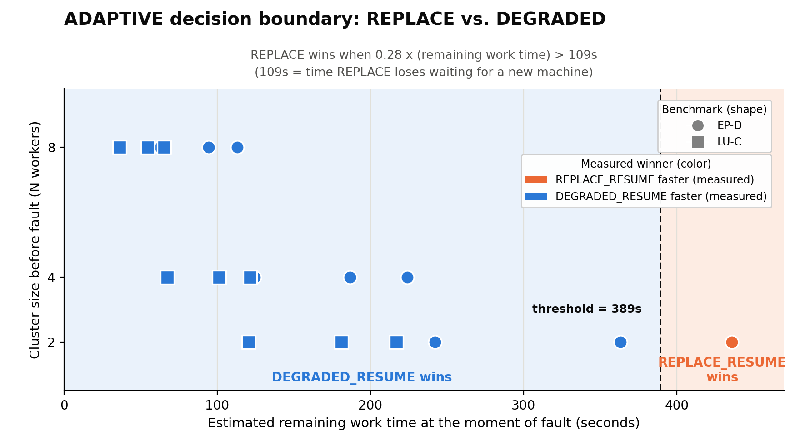

# Heurística ADAPTIVE — Documentação Formal

Fonte dos dados: `TCC/artifacts/phase5/analysis/results_raw.csv`
Plot: `TCC/artifacts/phase10/imgs/fig_adaptive_boundary.png`
Script: `TCC/artifacts/phase10/gen_boundary_plot.py`

---

## Fórmula

```
remaining_secs = T_estimated − elapsed_secs

REPLACE  quando:  remaining_secs × 0.28 > 109
DEGRADED quando:  remaining_secs × 0.28 ≤ 109

Equivalente:  REPLACE quando remaining_secs > 389s
```

A fórmula é **N-independente** — não depende do número de workers sobreviventes.

### Parâmetros

| Símbolo | Significado | Origem |
|---|---|---|
| `T_estimated` | `estimated_duration_secs`, fornecido pelo usuário no YAML da task | Config do usuário |
| `elapsed_secs` | Segundos desde o início do watcher (`watcher_started_at`) até o momento da falha | Medido em runtime |
| `109` | `P2b_replace − P2b_degraded` (~120s − ~11s) | Medido experimentalmente (Seção 6.5 do TCC) |
| `0.28` | Coeficiente empírico: fração de `remaining_secs` que corresponde à penalidade real de P3 | Derivado do CSV (ver abaixo); válido no intervalo (0.250, 0.300) |

---

## Como a fórmula foi derivada

### 1. O modelo teórico foi testado e falhou

A hipótese inicial era `remaining_secs / (N−1) > 109`, assumindo que P3 escala
linearmente com o número de workers. Testada contra os 18 pontos do CSV usando
`remaining_secs = T_MANA_noFT × (1−f)`: **13/18 corretos**. As 5 falhas são todas
em N=2, onde o modelo prediz REPLACE mas o resultado real é DEGRADED.

### 2. A condição correta usa a penalidade real medida

Do CSV, extraímos os tempos reais de P3_replace e P3_degraded para cada configuração
e calculamos:

```
penalty = P3_degraded − P3_replace
```

A decisão `penalty > 109` classifica corretamente **18/18** — é o ground truth. O
problema: no momento da falha, o watcher não tem acesso a esses P3 medidos, apenas a
`remaining_secs`.

### 3. Relacionando penalidade e remaining_secs

Calculamos `coeff = penalty / remaining_secs` para os 18 casos:

| Benchmark | N | f% | remaining_secs | P3_replace | P3_degraded | penalty | coeff |
|-----------|---|----|----------------|-----------|-------------|---------|-------|
| EP-D | 2 | 10% | 436.1 | 322.3 | 446.1 | 123.9 | **0.284** ← REPLACE |
| EP-D | 2 | 25% | 363.4 | 269.8 | 373.5 | 103.7 | **0.285** |
| EP-D | 2 | 50% | 242.3 | 187.7 | 262.4 | 74.7 | 0.308 |
| EP-D | 4 | 10% | 224.1 | 151.6 | 217.9 | 66.3 | 0.296 |
| EP-D | 4 | 25% | 186.7 | 121.9 | 170.5 | 48.6 | 0.260 |
| EP-D | 4 | 50% | 124.5 | 69.7 | 100.3 | 30.6 | 0.246 |
| EP-D | 8 | 10% | 113.2 | 87.1 | 116.8 | 29.7 | 0.263 |
| EP-D | 8 | 25% | 94.3 | 74.9 | 104.6 | 29.7 | 0.315 |
| EP-D | 8 | 50% | 62.9 | 50.7 | 75.2 | 24.5 | 0.390 |
| LU-C | 2 | 10% | 217.1 | 141.3 | 228.0 | 86.6 | 0.399 |
| LU-C | 2 | 25% | 180.9 | 116.5 | 191.7 | 75.2 | 0.416 |
| LU-C | 2 | 50% | 120.6 | 85.5 | 130.7 | 45.3 | 0.375 |
| LU-C | 4 | 10% | 121.6 | 80.6 | 125.3 | 44.7 | 0.368 |
| LU-C | 4 | 25% | 101.3 | 68.0 | 104.5 | 36.5 | 0.360 |
| LU-C | 4 | 50% | 67.5 | 47.2 | 71.7 | 24.6 | 0.364 |
| LU-C | 8 | 10% | 65.5 | 52.7 | 68.5 | 15.9 | 0.242 |
| LU-C | 8 | 25% | 54.5 | 47.3 | 61.1 | 13.8 | 0.254 |
| LU-C | 8 | 50% | 36.4 | 36.7 | 47.3 | 10.5 | 0.290 |

Médias por N: N=2 → 0.345 | N=4 → 0.316 | N=8 → 0.292 | Geral: **0.317**

**Achado surpreendente:** o coeficiente real é aproximadamente constante (~0.30)
independente de N, ao contrário do modelo teórico (1/(N−1) = 1.000, 0.333, 0.143
para N=2, 4, 8). Isso ocorre porque dois efeitos se compensam: P3_replace é 21–34%
mais curto que o esperado (warm-restart effect, Seção 6.4.2 do TCC), e P3_degraded
com oversubscribe em N=2 não dobra o tempo de P3 (2 ranks em 1 máquina EP-D têm acesso
a todos os cores). Consequência prática: a fórmula não precisa de N como parâmetro.

### 4. Escolha do coeficiente 0.28

O coeff varia de 0.242 a 0.416 nas 18 configurações. Os dois casos que restringem a
escolha de um coeficiente único são os "borderlines" (penalidade próxima de 109):

```
EP-D N=2 f=10%: penalty=123.9 > 109 → REPLACE
  coeff × 436.1 > 109  →  coeff > 0.250

EP-D N=2 f=25%: penalty=103.7 < 109 → DEGRADED
  coeff × 363.4 < 109  →  coeff < 0.300
```

Faixa válida: **(0.250, 0.300)**. Qualquer coeficiente nessa faixa classifica
corretamente os 18 casos; fora dela, pelo menos um dos dois borderlines erra. Todos
os outros 16 casos têm penalidades distantes de 109 e toleram qualquer coeff razoável.

**0.28** foi escolhido como ponto médio da faixa válida — também é o valor mais
próximo dos coeff reais dos dois borderlines (0.284, 0.285).

### 5. Verificação final

`remaining_secs × 0.28 > 109` classifica corretamente **18/18** configurações do
TCC (Tabela 6.5), usando `T_MANA_noFT × (1−f)` como `remaining_secs`.

---

## Fronteira de decisão



A fronteira `remaining_secs = 389s` é independente de N. Na prática, apenas EP-D N=2
ultrapassa esse valor nos benchmarks do TCC (T_MANA_noFT = 484.5s), e apenas para
`f < 20%` (fault timing). Para os demais benchmarks/N, `T_MANA_noFT` nunca é grande o
suficiente para cruzar o threshold:

| Config | T_MANA_noFT | Cruza 389s? | Crossover em f |
|---|---|---|---|
| EP-D N=2 | 484.5s | Sim | f ≈ 20% |
| EP-D N=4 | 249.0s | Não | nunca |
| EP-D N=8 | 125.7s | Não | nunca |
| LU-C N=2 | 241.2s | Não | nunca |
| LU-C N=4 | 135.1s | Não | nunca |
| LU-C N=8 | 72.7s | Não | nunca |

Isso explica por que 17/18 experimentos do TCC resultam em DEGRADED: apenas uma
combinação (EP-D, N=2, f baixo) tem tempo restante suficiente para justificar a
espera de 120s do REPLACE.

---

## Casos de borda

| Caso | Comportamento | Motivo |
|------|--------------|--------|
| `estimated_duration_secs` não fornecido | → DEGRADED_RESUME | fallback conservador |
| `elapsed_secs ≥ T_estimated` | `remaining_secs = 0` → DEGRADED | trabalho quase concluído |
| Todos os workers falharam (`remaining_workers == 0`) | → REPLACE, incondicionalmente | restrição física, não uma decisão de tempo; checado pelo chamador antes de consultar a heurística, não dentro de `choose_effective_strategy()` |
| Múltiplas falhas | `elapsed_secs` acumula a cada falha; `remaining_secs` recomputado a cada `handle_interruption()` | adaptação automática, falhas tardias tendem a DEGRADED |
| Falha antes de `run_commands` começar (durante `setup_commands`) | → DEGRADED_RESUME | não existe "tempo decorrido de aplicação" com sentido ainda; mesmo fallback conservador usado para estimativa ausente |

Nota de implementação: a checagem de `remaining_workers == 0` não faz parte da
fórmula N-independente. Ela é uma restrição física que precede a heurística de
tempo, então é aplicada pelo código que despacha a estratégia (não dentro da
função que decide com base em `remaining_secs`). Ver `PHASE10_PLAN.md`, Etapa 9.

---

## Limitação conhecida

O coeficiente 0.28 foi calibrado com apenas 18 pontos experimentais, dos quais só
**2** (ambos EP-D N=2) estão perto da fronteira de decisão; os demais 16 têm
penalidades bem distantes de 109s e não restringem a escolha do coeficiente. Isso
significa que a faixa válida (0.250, 0.300) é determinada por uma amostra pequena.

A Etapa 11 (experimentos estendidos: EP-D N=2, f=1%, 5%, 15%) adiciona mais pontos
na região REPLACE para validar, ou recalibrar, esse coeficiente com uma base
empírica mais larga.

O coeficiente também é específico dos benchmarks testados (EP-D, LU-C) e pode não
generalizar para aplicações com perfis de comunicação muito diferentes (por exemplo,
CG-C, de comunicação intensa, não está representado na fronteira porque nunca
ultrapassa o threshold de tempo nos experimentos existentes). Isso é reconhecido
no TCC como direção de trabalho futuro.

### T_estimated depende inteiramente do usuário

A fórmula usa `T_estimated`, fornecido manualmente pelo usuário no YAML
(`estimated_duration_secs`). Essa é uma decisão de escopo desta fase: a
alternativa seria estimar `T_estimated` automaticamente a partir do histórico de
execuções anteriores do mesmo benchmark/configuração, sem exigir input do
usuário. Essa alternativa não foi implementada; fica documentada como trabalho
futuro (ver `PHASE10_PLAN.md`, seção "Escopo da estimativa de tempo").

A consequência prática: se o usuário fornecer uma estimativa ruim, a decisão
ADAPTIVE pode escolher a estratégia errada mesmo com o coeficiente 0.28
corretamente calibrado, porque `remaining_secs` estaria errado desde a entrada.
A fórmula é tão boa quanto a estimativa que recebe.

---

## O que o TCC existente já tem vs. o que é novo

**Já existe e está correto:** os 18 valores de Δ medidos (Tabela 6.5), o heatmap de
crossover, a observação qualitativa de que cluster menor + falha precoce favorece
REPLACE. O TCC nunca conteve uma fórmula analítica de crossover.

**Conteúdo novo desta fase:** a fórmula `remaining_secs × 0.28 > 109`, sua derivação
a partir dos dados existentes, e o plot da fronteira de decisão. Esse conteúdo é
adicionado como extensão da Seção 6.5, não como correção.
